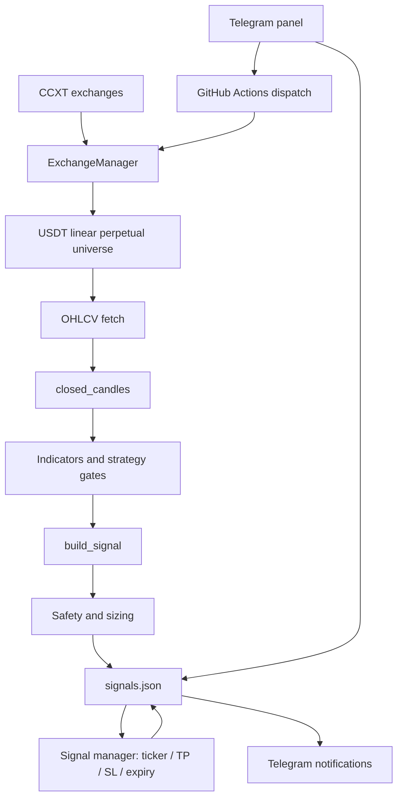

# Whiteboard architecture review

Review baseline: `hardening/risk-liquidity-entry-guards`

This document records the system as implemented, separates confirmed behavior from assumptions, and defines a safe refactoring path. It is an engineering review, not a claim that the strategy is profitable.

## 1. Current system map

### Current responsibilities

| Area | Current implementation | Main concern |
|---|---|---|
| Runtime configuration | `config.py` + imports in `bot.py` | Keep defaults and environment parsing centralized |
| Market access | `exchange.py` | CCXT lifecycle and market-universe discovery are isolated from orchestration |
| Candle hygiene | `market_data.py` | Closed-candle validation rejects forming, invalid and duplicate rows |
| Indicators and strategy | `indicators.py` + strategy functions in `bot.py` | Indicator math is extracted; strategy gates and signal construction still need separation |
| Risk and sizing | `risk.py`, `safety_filters.py` | Pure fee/slippage-aware sizing; keep stop-distance distinct from account/equity risk |
| Trade lifecycle | `manage_signal`, `close_piece` | Simulated price-based exits; not exchange-native stop orders |
| Persistence | `storage.py` via compatibility wrappers in `bot.py` | Atomic writes; malformed state fails closed instead of silently resetting history |
| Telegram | `notifications.py` + `panel.py` | Signal delivery is separated from the interactive control plane |
| Automation | `.github/workflows/bot.yml` | CI, scheduled operation and state persistence share one workflow |

## 2. Confirmed execution path

1. The scanner initializes the configured Bitget, OKX and Gate.io sources, plus exchanges needed by already-active signals.
2. It discovers active linear USDT-settled perpetual markets and requires 24-hour quote-volume evidence before a symbol enters the scan list.
3. OHLCV is fetched and the currently-forming candle is removed by `closed_candles`.
4. A new signal is eligible only shortly after a new 4-hour candle opens. The code requires the observed open to be no more than ten minutes old; it does not substitute the previous close.
5. The current reference setup uses RSI recovery, Stochastic confirmation, volume and ATR-based stop placement. The planned target is 1.5R.
6. Signals are persisted to `signals.json`. A later manager pass polls ticker prices and updates the simulated TP/SL lifecycle.
7. Telegram messages report signal and lifecycle events. The panel reads state and can dispatch the workflow.

## 3. Important boundaries and limitations

- **Signal simulator, not execution engine:** no exchange order placement or exchange-native protective stop is performed by this project.
- **Stop-distance is not portfolio risk:** `MAX_RISK_PCT` caps the entry-to-stop price distance. Dollar sizing is separately based on `RISK_USD` and `MAX_POSITION_USD`. Do not describe the 2.5% stop-distance cap as risking 2.5% of account equity.
- **Ticker-based exits are approximations:** polling frequency, gaps, spread, liquidity and real fills can differ from the simulated exit price.
- **Single JSON state is a single-writer design:** simultaneous runners or a panel process writing the same state can lose updates. Keep workflow concurrency and state writes serialized.
- **A successful CI run is not a strategy validation:** it proves selected code paths pass tests, not that future returns are positive.

## 4. Risks identified and addressed in this pass

| Finding | Action |
|---|---|
| Configuration was embedded in the 2,300-line runtime file | Extracted defaults and environment settings to `config.py` |
| Management-only execution still required a scanner exchange | Added a mode that initializes only exchanges needed by active signals |
| Price floor was enforced in scanner flow but could be bypassed by direct signal construction | Added the same guard inside `build_signal` |
| Net target RR calculation needed explicit fee/slippage semantics | Documented and regression-tested target net reward against planned price-distance risk; stop-side costs remain in sizing |
| README described spot markets and a different schedule | Align documentation with perpetual markets and the actual 5-minute workflow |

## 5. Target architecture

Refactor incrementally into small modules while preserving public imports used by `panel.py` and existing tests:

- `config.py`: immutable runtime settings and environment parsing
- `exchange.py`: CCXT lifecycle and market-universe adapters
- `market_data.py`: OHLCV normalization and closed-candle validation
- `indicators.py`: pure indicator calculations
- `notifications.py`: Telegram signal delivery
- `utils.py`: dependency-light numeric and formatting helpers
- `storage.py`: schema-checked state loading and atomic persistence
- `market_data.py`: OHLCV validation, closed-candle handling and freshness checks
- `indicators.py`: pure indicator calculations
- `strategy.py`: setup gates and signal candidate generation
- `risk.py`: fee/slippage-aware sizing and risk calculations
- `safety_filters.py`: symbol, liquidity and stop-distance admission filters
- `trade_manager.py`: deterministic TP/SL/expiry state transitions
- `storage.py`: validated, atomic state reads/writes and schema migration
- `notifications.py`: Telegram delivery with retry and delivery observability
- `panel.py`: Telegram control-plane only; no strategy calculations

`bot.py` should become a thin orchestration/CLI layer. Extract one boundary at a time; do not move the whole monolith in a single untested change.

## 6. Required engineering gates

Before production deployment:

1. Compile every application and test module.
2. Run the full unit suite and add regression tests for every changed state transition.
3. Test missing, stale and malformed exchange responses.
4. Test duplicate suppression, repeated workflow runs and JSON schema compatibility.
5. Run chronological out-of-sample replay with fees, spread/slippage, gaps and conservative fill assumptions.
6. Compare paper-forward results to replay; disclose sample size and confidence limitations.
7. Keep real order execution disabled until a separate execution design, exchange testnet suite and kill-switch review exist.

## 7. Review verdict

The project has useful strategy and lifecycle tests, but the runtime is still a monolith and the state store is file-based. This pass extracts configuration, exchange access, OHLCV validation, indicators, notifications, numeric parsing and state persistence into focused modules, and fixes confirmed mode/documentation defects. It does not claim a full modular rewrite or a 10/10 production-readiness score.
